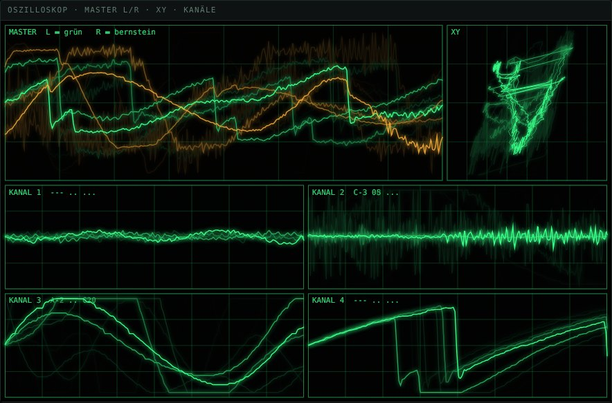
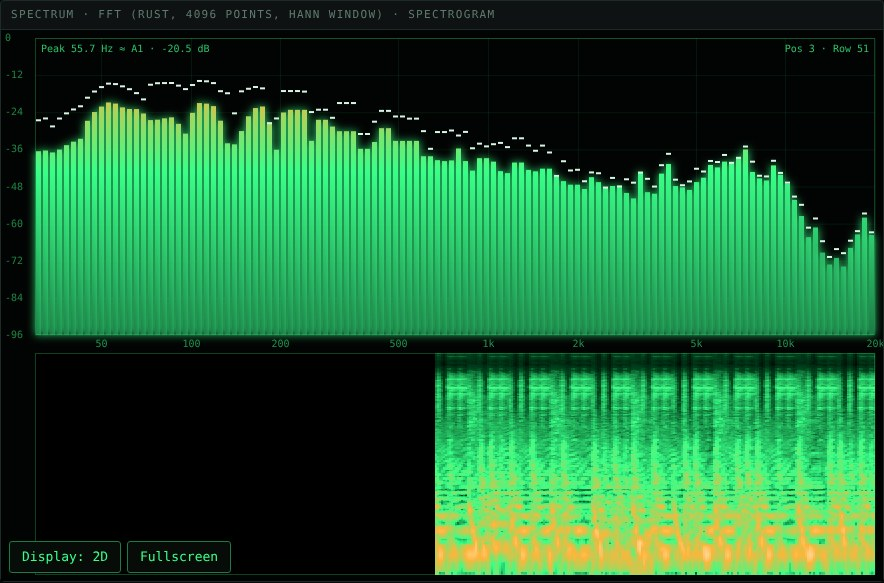
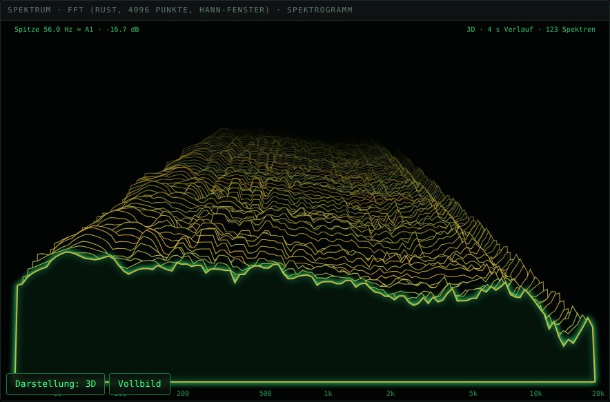
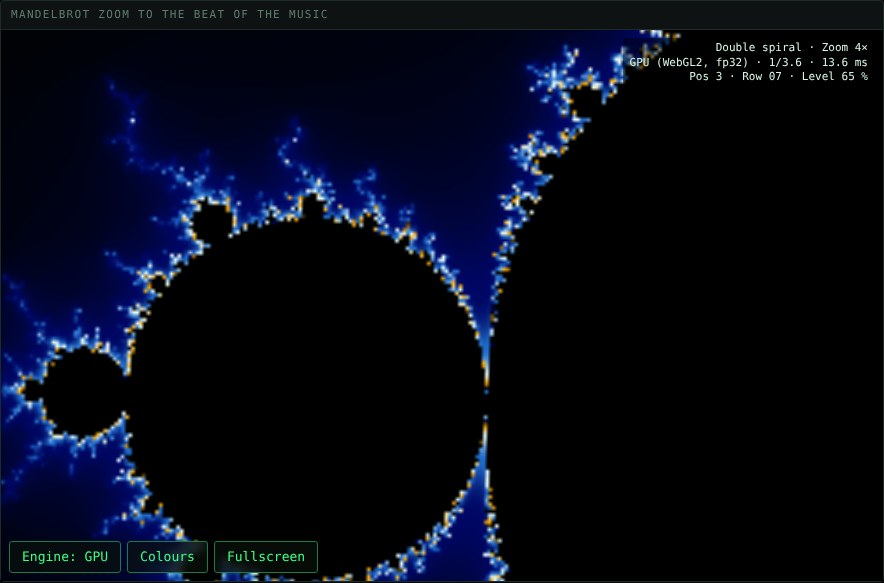
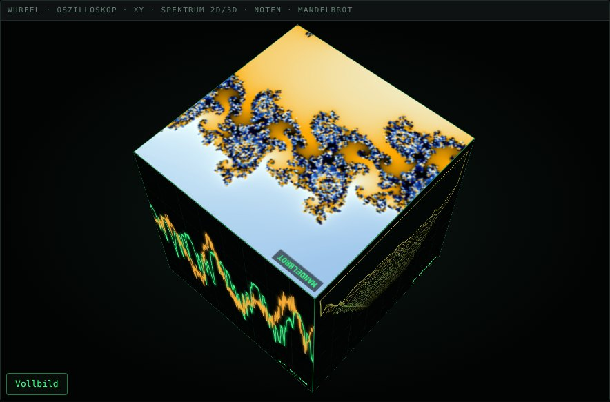
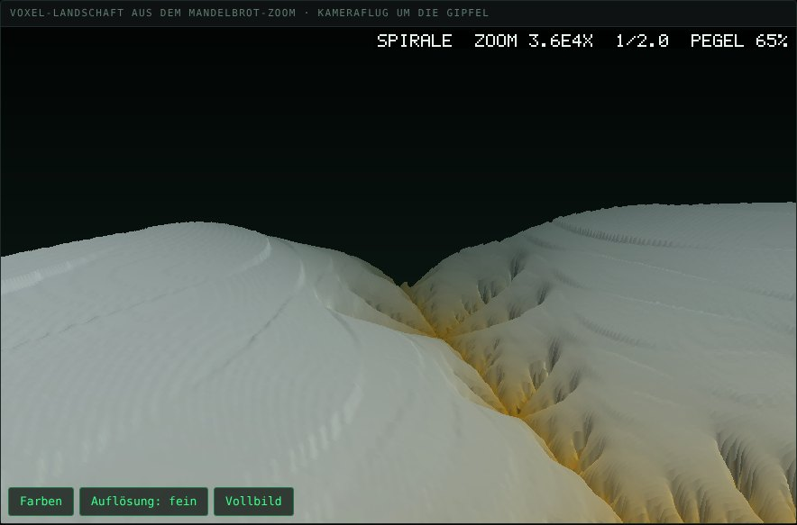
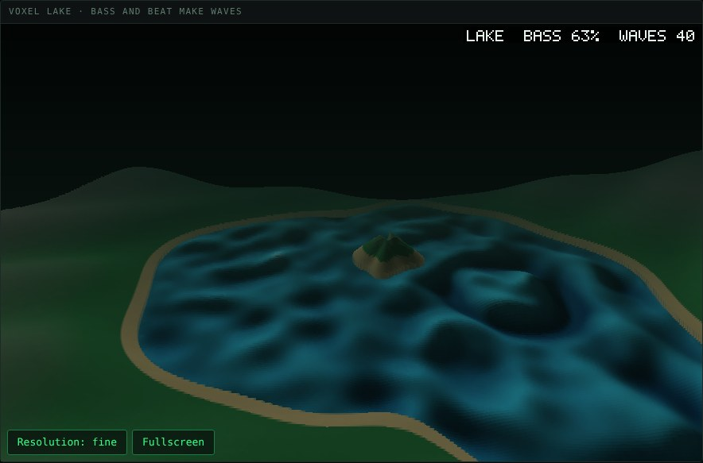
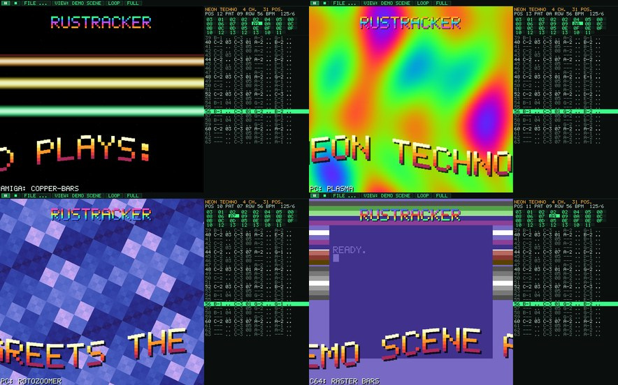
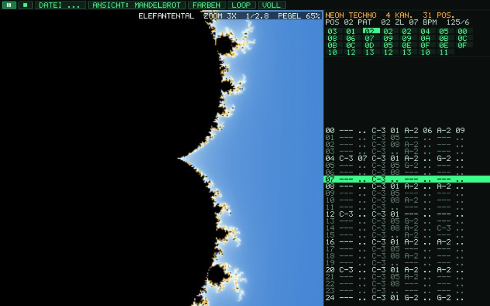
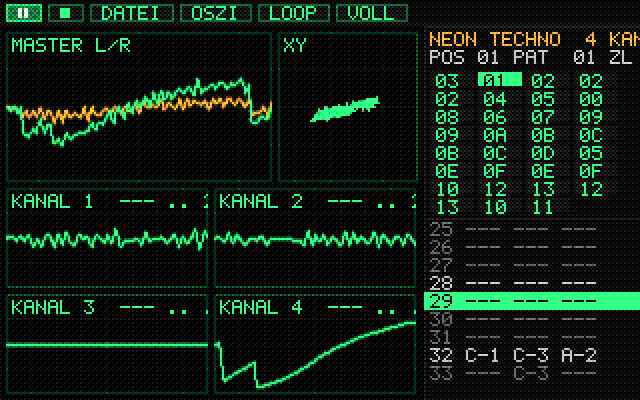

# Rust MOD Tracker (WebAssembly) mit Oszilloskop

[](https://github.com/MarkusFlad/rustracker/actions/workflows/ci.yml)

ProTracker-MOD-Player, geschrieben in Rust ohne externe Crates. Er wird zu WebAssembly
kompiliert und spielt im Browser über ein AudioWorklet ab. Dazu gibt es ein Oszilloskop
(Master L/R, XY-Lissajous und eine Spur pro Kanal) und eine Pattern-Ansicht wie in einem Tracker.

**Live-Demos** (von der CI bei jedem Push gebaut und auf GitHub Pages veröffentlicht):

- [▶ Klassische Edition](https://markusflad.github.io/rustracker/): Oberfläche in HTML/Canvas, Mandelbrot auf der GPU (WebGL2) oder mit dem Rust-SIMD-Kern
- [▶ Framebuffer-Edition](https://markusflad.github.io/rustracker/fb/): jedes Pixel von Rust gezeichnet, nur ein paar Zeilen JavaScript
- [▶ Promo-Video](https://markusflad.github.io/rustracker/video/): gut eine Minute Rustracker, gerendert vom Rustracker selbst
- [▶ DOS-Edition](https://markusflad.github.io/rustracker/dos/): derselbe Rust-Code für Pentium, VGA 320×200 und Sound Blaster, mit Screenshots aus DOSBox und der ZIP für einen echten PC oder DOSBox

[](https://markusflad.github.io/rustracker/video/)

## Ansichten

Alle Ansichten reagieren live auf die Musik. Umschalten mit **View** (in der
Framebuffer-Edition auch mit der Taste V). Die Bilder stammen aus der klassischen Edition.
Die Oberfläche ist in allen Editionen englisch beschriftet.

| | |
|---|---|
| <br>**Oszilloskop**: Master L/R, XY-Figur und eine Spur pro Kanal | <br>**Spektrum 2D**: FFT-Balken mit Spitzenwerten und Spektrogramm |
| <br>**Spektrum 3D**: die letzten 4 Sekunden in die Tiefe | <br>**Mandelbrot-Zoom** im Takt der Musik |
| <br>**Würfel** mit sechs Live-Flächen | <br>**Voxel-Landschaft** aus dem Mandelbrot-Zoom |
| <br>**See aus Voxeln**: Bass und Takt erzeugen Wellen | <br>**Demoszene**: Copper-Bars, Plasma, Rotozoomer, Rasterzeilen, Sinus-Scroller |
| <br>**Framebuffer-Edition**: jedes Pixel in Rust gezeichnet | |

## Starten

Ausprobieren geht am schnellsten über die Live-Demos oben. Lokal:

```sh
./build.sh          # baut die WASM-Dateien und startet http://localhost:8080
```

Die WASM-Dateien (`modplayer.wasm`, `mandel.wasm`) liegen nicht im Repository: `.gitignore`
hält `*.wasm` und `*.wav` heraus, und die CI baut sie bei jedem Push selbst. `build.sh` erzeugt
sie lokal und kopiert sie nach `www/` und `www-fb/`. Danach startet es den Webserver für die
klassische Edition. Für die Framebuffer-Edition:

```sh
./build.sh --no-serve && cd www-fb && python3 -m http.server 8080
```

Voraussetzung für den Build: rustup/cargo und Python 3 (für den lokalen Webserver). Das Skript
installiert das Target `wasm32-unknown-unknown`, falls es fehlt. wasm-bindgen oder wasm-pack
werden nicht gebraucht. Wer nur die fertigen Dateien will, findet sie auch im Artefakt `site`
jedes CI-Laufs (Tab *Actions*).

Im Browser auf **Play** tippen. Standard-Song ist „Neon Techno“ von Drozerix (`www/drozerix_-_neon_techno.mod`, Public Domain, siehe [CREDITS.md](CREDITS.md)). Daneben liegen die eigenen Stücke „Orbitalfunk“ und „November Static“. Einen anderen Standard-Song bettest du mit `python3 scripts/embed_song.py <datei.mod>` in `www/song.js` ein. Fremde Module bitte nicht committen; `.gitignore` hält zum Beispiel `www/12th_warrior.mod` heraus. Eigene `.mod`-Dateien lassen sich über **File …** oder per
Drag & Drop laden. Wenn du auf eine Position in der Order-Liste tippst, springt der Player dorthin.

### Ohne wasm32-Target bauen

Die ganze Bibliothek (Replayer, FFT, Renderer, API) verwendet nur den Sprachkern: keine
Iteratoren, keine `Option`, keine Slices, keine Allokation, keine Methoden aus `core`. Deshalb
lässt sie sich auch ohne installiertes wasm32-Target mit einem winzigen Ersatz für `core`
direkt nach WebAssembly übersetzen. Die CI baut diese Variante zur Kontrolle bei jedem Push mit:

```sh
mkdir -p preview/out
RUSTC_BOOTSTRAP=1 rustc --edition 2021 --target wasm32-unknown-unknown --crate-type cdylib \
  -C opt-level=3 -C panic=abort -C overflow-checks=no -C strip=symbols \
  -o preview/out/modplayer.wasm preview/minicore.rs
cp preview/out/modplayer.wasm www/ && cp preview/out/modplayer.wasm www-fb/
```

Die so gebaute WASM-Datei gibt den Song bis auf ±1 LSB identisch mit dem nativen Build aus.

## Nativ testen

```sh
cargo test
cargo run --release --bin mod2wav -- www/november_static.mod song.wav
cargo run --release --bin fbshot -- www/drozerix_-_neon_techno.mod /tmp/frames 1280 800
```

## Dokumentation

Jede öffentliche Funktion ist mit Zweck, Argumenten und Rückgabewert dokumentiert (die CI
bricht ab, wenn etwas fehlt). Als HTML ansehen:

```sh
cargo doc --no-deps --open
```

## Aufbau

| Datei | Inhalt |
|---|---|
| `src/replayer.rs` | MOD-Parser, Effekte, Mixer (lineare Interpolation, LRRL-Panning, Lautstärkerampen) |
| `src/fft.rs` | wiederverwendbare FFT (Radix-2, Hann-Fenster) mit linearem Puffer oder Ringpuffer als Eingang |
| `src/spectrum.rs` | Auswertung eines Leistungsspektrums: Bänder, Spitze mit Parabel-Interpolation, Log-Frequenzachse, dB-Skala |
| `src/math.rs` | Mathematik ohne `core`: sin/cos, log2/log10, exp2, pow, sqrt, Begrenzungen |
| `src/api.rs` | schlanke C-ABI-Exporte (`mp_load`, `mp_render`, `mp_channels_ptr`, `vis_*`, …) |
| `src/lib.rs` | bindet alles ein; auf wasm32 `no_std`, `#![warn(missing_docs)]` |
| `preview/minicore.rs` | Mini-Ersatz für `core`, für Builds ohne wasm32-Target |
| `src/bin/mod2wav.rs` | Werkzeug zum nativen Rendern in eine WAV-Datei |
| `www/worklet.js` | AudioWorklet: ruft `mp_render` auf und schickt Scope-Daten an die Oberfläche |
| `www/index.html` | Oberfläche, Oszilloskop (Canvas mit Phosphor-Nachleuchten), Pattern-Ansicht, Musik-Regie für den Mandelbrot-Zoom |
| `www/mandel.js` | Mandelbrot-Engine aus dem Echtzeit-Zoomer: GPU (WebGL2, fp32/df64) und der Rust-SIMD-Kern in Web Workern |
| `www/rustvis.js` | Anbindung des Rust-Renderers (`src/vis.rs`) an eine Seite: eigene WASM-Instanz, Worklet-Daten, Worker für den Mandelbrot-Kern; genutzt von der Framebuffer-Edition und von den Voxel-Ansichten der klassischen |
| `kernel/mandel_wasm.rs` | der SIMD-Kern des Zoomers (f64x2, 8 Pixel verschränkt), gebaut zu `mandel.wasm`; liefert Farben oder Palettenindizes |

Unterstützt werden 15/31-Sample-MODs mit 4 bis 32 Kanälen (M.K., FLT4/8, xCHN, xxCH)
und die ProTracker-Effekte 0–F. Dazu gehören auch die E-Befehle: Fine Slides, Loop,
Retrigger, Note Cut/Delay und Pattern Delay.

## Spektrum-Ansicht

Über **View** wechselst du vom Oszilloskop zum Frequenzspektrum der Musik. Die API (`src/api.rs`) hält dafür die
letzten 4096 Samples des Mixes (Mono) in einem Ringpuffer. `mp_spectrum(4096)` berechnet daraus
mit einer eigenen FFT (Radix-2, Cooley-Tukey, Hann-Fenster) das Leistungsspektrum. Das geschieht
alle 1024 Samples, also mit 75 % Überlappung. Die FFT kommt ohne `core`-Mathematik aus: Sinus und
Kosinus für die Twiddle-Faktoren kommen per Taylor-Reihe aus `src/math.rs`. Getestet ist sie gegen eine naive
DFT (`cargo test`).

Angezeigt werden:
- Balken auf logarithmischer Frequenzachse (30 Hz bis 20 kHz) mit Spitzenwert-Markern, Skala in dB.
- Ein mitlaufendes Spektrogramm darunter.
- Die stärkste Frequenz mit Notenname.

Mit **Display: 3D** wird das Spektrum in die Tiefe erweitert. Vorne steht das aktuelle
Spektrum, dahinter liegen die Spektren der letzten 4 Sekunden. Sie rücken perspektivisch nach
hinten, werden kleiner und blasser und verdecken einander (Maleralgorithmus). Was älter als
4 Sekunden ist, wird nicht mehr gezeichnet. In lauten Passagen färben sich die Linien von Grün
nach Bernstein.

## Mandelbrot-Ansicht

Nach dem Spektrum folgt der Mandelbrot-Zoom. Das Timing kommt direkt
aus dem Replayer: Position, Zeile, Speed und BPM. Ein Schlag sind 4 Zeilen, ein Takt 16 Zeilen.

- Jede Order-Position startet eine neue Fahrt zu einem anderen Ort im Apfelmännchen, mit einem Lichtblitz auf der Eins.
- Jeder Schlag gibt einen Zoom-Schub. Je lauter die Musik, desto schneller geht es hinein.
- Der Bildmittelpunkt wandert pro Schlag eine Vierteldrehung im Kreis, und pro Takt schwingt das Bild nach links oder rechts.
- Jede gespielte Note verschiebt die Farbpalette.

Die Anzeige läuft um die Audio-Ausgabelatenz verzögert, damit Bild und Ton zusammenpassen.
Doppelklick oder **Fullscreen** füllt den Bildschirm.

## Songs

Die beiden eigenen Songs werden von Python-Skripten in `songs/` erzeugt. Sie synthetisieren alle Samples
selbst und schreiben die MOD-Datei. Dafür werden Python 3 und numpy gebraucht.

- `songs/make_space.py` → „Orbitalfunk“: 8 Kanäle (8CHN), D-Moll, 124 BPM. Lead mit Echo-Kanal, Arpeggio, Pad mit eingebautem Einschwingen, Oktav-Bass, Drums mit Gated-Snare.
- `songs/make_mod.py` → „November Static“: 4 Kanäle (M.K.).

## Würfel-Ansicht

Die vierte Ansicht zeigt einen langsam taumelnden 3D-Würfel. Er ist mit CSS-3D gebaut, also
perspektivisch korrekt und mit scharfer Schrift. Jede der sechs Seiten ist eine eigene Canvas,
die jedes Bild neu gezeichnet wird:

- Master L/R
- XY
- Spektrum 2D
- Spektrum 3D mit 4 s Verlauf
- Tracker-Noten des aktuellen Patterns
- Mandelbrot-Zoom, eine eigene GPU-Instanz mit derselben Musik-Regie

Der Würfel dreht sich um zwei Achsen, sodass nach und nach jede Seite nach vorne kommt. Auf
jedem Schlag pulsiert er leicht, auf der Eins jedes Takts etwas stärker.

## Voxel-Ansicht

Die fünfte Ansicht macht aus dem Mandelbrot-Zoom eine Landschaft aus Voxeln. Grundlage ist
dasselbe Bild der Musik-Regie, als quadratische Karte der Iterationszahlen:

- Die Mandelbrotmenge selbst liegt auf Höhe null.
- Je weniger Iterationen ein Punkt braucht, desto höher liegt er. Die Höhen sind über das Bild
  histogramm-normiert: Die Höhe ist der Anteil der Punkte, die mehr Iterationen brauchen. So
  verteilen sie sich gleichmäßig, und die Bereiche mit den wenigsten Iterationen bilden die Gipfel.
- Jedes Voxel hat die Farbe des 2D-Bildes, inklusive Palettenverschiebung und Lichtblitz, und
  wird nach seiner Neigung beleuchtet. In der Ferne verschwimmt es im Dunst.
- Die Kamera umkreist die Landschaft einmal pro Minute und schaut dabei links an der Mitte vorbei,
  fliegt also um die Gipfel herum. Auf jedem Schlag sinkt sie ein kleines Stück ab.
- Der Zoom der Musik-Regie lässt die Landschaft wachsen. Ein neues Bild ersetzt die Karte erst,
  wenn es fertig ist, dazwischen wird das alte passend zum aktuellen Zoom umgerechnet.

Gezeichnet wird mit dem klassischen Voxel-Space-Verfahren: ein Strahl pro Bildspalte, von vorn
nach hinten über die Höhenkarte, jede Stelle als senkrechter Streifen über dem, was schon näher
liegt. Der Code steckt in `src/vis_voxel.rs` und `src/voxel_space.rs`; die Karte rechnet der
SIMD-Kern in den Workern. Beide Editionen nutzen dafür denselben Rust-Renderer (siehe unten).

## See-Ansicht

Die sechste Ansicht zeigt einen See aus Voxeln, den die Musik zum Schwingen bringt:

- Die Wasseroberfläche ist eine zweidimensionale, leicht gedämpfte Wellengleichung auf einem
  Gitter (240 × 240 Zellen, 120 Schritte pro Sekunde). Wellenberge und -täler addieren und
  löschen sich deshalb wie bei echten Wellen, und am Ufer werden sie zurückgeworfen.
- Jeder Einsatz des tiefsten Basses (etwa 30 bis 75 Hz, der Pegel springt über seinen
  gleitenden Mittelwert) wirft einen „Stein“ ins Wasser, je stärker der Sprung, desto tiefer
  die Delle. Schläge ohne Bass-Einsatz werfen einen kleineren. Von dort läuft eine konzentrische
  Welle los.
- Die Stelle, an der die Steine fallen, wandert langsam im Kreis um die Mitte des Sees.
- Das Ufer ist unregelmäßig geformt (ein Kreis, verformt durch einige Oberschwingungen mit
  festen Phasen), und in der Nähe der Mitte liegt eine kleine Insel. An beiden werden die Wellen
  zurückgeworfen.
- Das Wasser ist türkis, auf den Wellenbergen heller und mit Schaum auf hohen Kämmen, und wird
  nach seiner Neigung beleuchtet. Das Ufer steigt zu Hügeln an: Sand, Gras, weiter oben Fels.
- Die Kamera fliegt langsam: etwa eine Minute für eine Runde um den See, in etwa anderthalb
  Minuten einmal weg und wieder heran, in etwa einer Minute einmal hoch und wieder herab. Der
  Blick folgt dabei so, dass der See im Bild bleibt.

**Auflösung:** In beiden Voxel-Ansichten schaltet der Knopf **Coarse/Fine** (Taste R, in der
klassischen Edition „Resolution“) zwischen einer glatten Oberfläche (Standard) und den kantigen Voxeln um.
Fein interpoliert Höhen und Farben bilinear zwischen den Zellen und tastet die Strahlen enger ab.
Beim See entscheidet der feine Modus außerdem pro Bildpunkt anhand des interpolierten Abstands zur
Uferlinie, ob Wasser, Strand oder Wiese zu sehen ist; das Ufer wird so zur glatten Kurve statt
der Treppe der Gitterzellen. Das kostet etwa die doppelte bis dreifache Rechenzeit.

Beide Voxel-Ansichten nutzen den Renderer `src/voxel_space.rs`, und zwar in beiden Editionen:
Die klassische Edition startet dafür eine eigene Instanz von `modplayer.wasm` im Haupt-Thread,
gibt ihr Song und Worklet-Daten und lässt sie mit `vis_view` nur die jeweilige Ansicht zeichnen
(Anbindung in `www/rustvis.js`, die auch die Framebuffer-Edition nutzt). So gibt es den
Algorithmus nur einmal, und er läuft überall als kompiliertes WebAssembly.

## Demoszene-Ansicht

Die siebte Ansicht ist eine Verbeugung vor der Demoszene, in der Tracker und das MOD-Format groß
geworden sind. Mit jeder neuen Song-Position wechselt sie zum nächsten klassischen Effekt:

- **Amiga – Copper-Bars:** ein schimmernder Farbbalken pro Kanal, der auf einer Sinusbahn durch
  ein Sternenfeld schwingt; spielt der Kanal eine Note, leuchtet sein Balken weiß auf.
- **PC – Plasma:** vier überlagerte Sinuswellen, deren Summe eine rotierende Farbpalette
  ansteuert.
- **PC – Rotozoomer:** eine XOR-Textur, die sich dreht, zoomt und auf dem Schlag pulsiert.
- **C64 – Rasterzeilen:** Farbbalken in der C64-Palette laufen durch den Rahmen um den blauen
  Bildschirm mit „READY.“ und blinkendem Cursor.

Über allem hüpft das Logo „RUSTRACKER“ auf jedem Schlag, und ein Sinus-Scroller zeigt den
Songtitel, die Sample-Namen (in denen Musiker traditionell Grüße versteckt haben) und Grüße an
die Szene. Plasma und Rotozoomer rechnen in den inneren Schleifen nur mit ganzen Zahlen und
Tabellen und laufen deshalb auch in der DOS-Edition flott. Die Ansicht steckt in
`src/vis_demo.rs` und wird in allen Editionen von Rust gezeichnet.

## Benchmark

Alle Editionen haben einen Benchmark: Er zeigt jede Szene (Oszilloskop, Spektrum 2D und 3D,
Mandelbrot, Würfel, Voxel, See, Demoszene) 15 Sekunden lang, mit dem Song von Anfang an, und
zeigt danach eine Tabelle:

```
RUSTRACKER BENCHMARK  15 S PER SCENE  1265 X 791
SCENE          FPS   MIN      MS    1ST  PIC/S
OSCILLOSCOPE  60.0  59.9     3.2     17      -
MANDELBROT    52.4  51.4    17.2     28   19.5
…
SCORE (GEOMETRIC MEAN OF FPS) 58.5
```

| Spalte | Bedeutung |
|---|---|
| FPS | Bilder pro Sekunde im Mittel (ohne das erste Bild) |
| MIN | die langsamste volle Sekunde |
| MS | Rechenzeit pro Bild in ms: im Browser die gemessene Zeit im Haupt-Thread, unter DOS die Zeit von Bild zu Bild |
| 1ST | Dauer des ersten Bilds in ms, mit dem Aufbau der Ansicht (der See baut seine Landschaft, der Zoom sein erstes Bild) |
| PIC/S | fertige Mandelbrot-Bilder pro Sekunde (Zoom, Würfel, Voxel); das Bild passt seine Auflösung an |
| SCORE | geometrisches Mittel der FPS, damit eine schnelle Szene keine langsame überdeckt |

Starten:
- Framebuffer-Edition und DOS: Taste **B** (noch einmal B bricht ab, jede Taste schließt die Tabelle).
- Klassische Edition: Knopf **Benchmark**; die Tabelle erscheint unter der Kopfzeile.
- Im Browser startet `?bench` bzw. `?bench=SEKUNDEN` in der Adresse den Benchmark mit dem ersten Klick
  (Audio braucht eine Geste), z. B. [fb/?bench](https://markusflad.github.io/rustracker/fb/?bench).
- DOS: `RTRACK /B`. Die Tabelle steht danach auch in `BENCH.TXT`; `SET RTRACK=B3` läuft mit 3 Sekunden
  pro Szene und beendet sich danach (für automatische Tests).

Unter DOS folgt eine zweite Tabelle, wenn die CPU einen Zeitstempelzähler hat (ab Pentium,
Befehl `RDTSC`). Sie teilt jedes Bild in Takten auf: Audiodaten und FFT (**IN**), der
Rust-Renderer (**DRAW**), Palette und Umrechnung (**PAL**), Kopieren in den VGA-Speicher
(**VGA**), dazu der Anteil des Sound-Interrupts (**SND%**) und die Bildrate, die beim normalen
Abspielen mit Warten auf den Strahlrücklauf herauskäme (**70HZ**). Die Taktfrequenz misst das
Programm selbst über die Abspielzeit des Sound Blasters. Diese Tabelle steht in den Meldungen
nach dem Beenden und in `BENCH.TXT`, nicht auf dem Bildschirm.

Im Browser begrenzt `requestAnimationFrame` die Bildrate auf die des Bildschirms (meist 60 Hz);
dort ist **MS** die aussagekräftigere Spalte. Die klassische Edition zeichnet Würfel (CSS 3D) und
Mandelbrot-Zoom (WebGL) zum Teil auf der GPU, deren Arbeit in MS nicht enthalten ist. Unter DOS
wartet der Benchmark nicht auf den Strahlrücklauf, sonst wäre bei 70 Bildern pro Sekunde Schluss.

Die Abläufe und die Tabelle stehen in `src/vis_bench.rs` und sind für alle Editionen dieselben:
In der Framebuffer- und der DOS-Edition schaltet Rust die Szenen selbst um, die klassische
Edition fragt Rust nach der Szene (`vis_bench_tick`, `vis_bench_view`) und zeichnet sie selbst.

## Continuous Integration

`.github/workflows/ci.yml` läuft bei jedem Push und Pull Request:

| Job | Prüft |
|---|---|
| **Rust** | `cargo fmt --check`, `cargo clippy -D warnings`, `cargo doc` (jedes öffentliche Element dokumentiert, keine kaputten Links), `cargo test`, natives Rendern der drei Songs |
| **WebAssembly** | Build mit `cargo` für `wasm32-unknown-unknown` **und** über `preview/minicore.rs`. Der zweite Build stellt sicher, dass die Bibliothek weiterhin nur den Sprachkern nutzt. Dazu kommt der Mandelbrot-SIMD-Kern (`mandel.wasm`). Danach laufen in Node `tests/wasm_smoke.mjs` (Exporte, Laden, Klang, FFT, Vergleich mit dem nativen Rendern auf ±2 LSB) und `tests/vis_smoke.mjs` (Framebuffer-Renderer, mit und ohne SIMD-Kern). Zum Schluss werden die Skripte beider Seiten geprüft und die Website als Artefakt `site` gebaut. |
| **Songs** | Erzeugt die beiden eigenen Songs neu aus `songs/*.py` und prüft, dass der Rust-Player sie abspielt |
| **Video** | Nicht bei Pull Requests: rendert das Promo-Video mit `tools/promo/make_video.sh` (siehe unten) und stellt es als Artefakt `video` bereit |
| **DOS** | Baut die DOS-Edition (`dos/build.sh`), lässt sie im Linux-Testrahmen ohne Hardware durch alle Ansichten laufen (`dos/selftest_check.py`), spielt sie in DOSBox mit Sound Blaster 16 ab (`dos/dosbox_test.sh`: 8 s mit dynamischem, 30 s mit normalem CPU-Kern, mit Screenshots, dazu ein Benchmark mit 3 s pro Szene; noch nicht blockierend) und packt ZIP, Seite und Bilder als Artefakt `dos` |
| **Pages** | Nur bei Push auf den Standard-Branch (`main` oder `master`): veröffentlicht beide Editionen mit „Neon Techno“ auf GitHub Pages (klassisch unter `/`, Framebuffer unter `/fb/`), das Promo-Video unter `/video/` und die DOS-Edition unter `/dos/` |

Für GitHub Pages musst du einmalig unter *Settings → Pages → Source* „GitHub Actions“ wählen.
Danach öffnet [https://markusflad.github.io/rustracker/](https://markusflad.github.io/rustracker/) direkt den Tracker und [https://markusflad.github.io/rustracker/fb/](https://markusflad.github.io/rustracker/fb/) die Framebuffer-Edition; die WASM-Dateien dafür baut die CI bei jedem Push neu.

Lokal laufen dieselben Prüfungen mit:

```sh
cargo fmt --check && cargo clippy --all-targets -- -D warnings && cargo test
RUSTFLAGS="-D missing_docs" RUSTDOCFLAGS="-D warnings" cargo doc --no-deps
./build.sh --no-serve
cargo run --release --bin mod2wav -- www/drozerix_-_neon_techno.mod /tmp/native.wav 10
node tests/wasm_smoke.mjs www/modplayer.wasm www/drozerix_-_neon_techno.mod /tmp/native.wav
node tests/vis_smoke.mjs www-fb/modplayer.wasm www/drozerix_-_neon_techno.mod www-fb/mandel.wasm
```

## DOS-Edition (`dos/`)



Der Rustracker läuft auch unter DOS, auf einem Pentium mit VGA und Sound Blaster. Replayer,
FFT und Framebuffer-Renderer sind dieselben Quellen wie im Browser; weil sie nur den Sprachkern
nutzen, übersetzt `rustc` sie ohne Änderung für `i586-unknown-linux-gnu` (Pentium ohne MMX/SSE,
Gleitkomma auf der x87-FPU). Dazu kommen ein paar hundert Zeilen DOS-Schicht:

| Datei | Aufgabe |
|---|---|
| `dos/stub.asm` | `RTRACK.COM`, 16-Bit-Lader: lädt `RTRACK.BIN` und den Song über XMS (oder INT 15h) in den Erweiterungsspeicher, reserviert den DMA-Puffer, schaltet VGA-Modus 13h ein und springt in den 32-Bit-Protected-Mode; danach stellt es Real Mode, Interrupt-Controller und Textmodus wieder her und zeigt die Meldungen des Programms |
| `dos/entry.asm` | 32-Bit-Einstieg: Interrupt-Tabelle, Interrupt-Controller auf 20h–2Fh, FPU-Zustand im Interrupt sichern, Ports für Rust |
| `dos/dos.rs` | Sound Blaster 16 (44,1 kHz Stereo, 16 Bit) oder 2.0/Pro (22 kHz Mono, 8 Bit) mit Auto-Init-DMA, gemischt im Interrupt; Tastatur; Umrechnung der RGBA-Bilder auf eine Palette, die dem Bild folgt (die 256 häufigsten Farben aus den 262 144 der VGA, die übrigen auf die nächstliegende abgebildet, ohne Dithering); Anzeige im vertikalen Strahlrücklauf |
| `dos/rt.asm` | `memcpy` und Co., die der Compiler aufruft |
| `dos/rtrack.rs` | Crate-Wurzel: bindet `src/` mit `--cfg dos` ein (kleine Puffer, Linien in Festkomma statt vieler langsamer Gleitkomma-Umwandlungen) |
| `dos/selftest.asm` | Linux-Testrahmen (i386): spielt ohne Hardware und schreibt das letzte Bild |

Bauen (braucht `nasm`, `ld.lld` und das Target `i586-unknown-linux-gnu`):

```sh
rustup target add i586-unknown-linux-gnu
dos/build.sh selftest                                   # -> dos/out/RTRACK.COM, RTRACK.BIN, NEON.MOD
python3 dos/selftest_check.py www/drozerix_-_neon_techno.mod /tmp/dos   # alle Ansichten als PNG
dos/package.sh /tmp/dos-site                            # ZIP und Seite
```

Auf dem PC: `RTRACK [/M] [/W] [/V] [/B] [datei.mod]`, Tasten wie in der Framebuffer-Edition (Esc beendet).
`/B` startet den [Benchmark](#benchmark).
Mandelbrot-Zoom (`/M`), Würfel (`/W`) und Voxel-Landschaft (`/V`) sind für einen Pentium 133 zu
aufwendig und deshalb nur auf Wunsch dabei. Nötig sind
16 MB RAM (das Programm belegt etwa 10 MB), die Variable `BLASTER` und DOS im Real Mode:
HIMEM.SYS ist in Ordnung, EMM386, QEMM oder eine Windows-DOS-Box nicht. Pattern-Tabelle,
Oszilloskop, Spektrum und Demoszene-Ansicht sind auf einen Pentium 133 ausgelegt; Mandelbrot,
Würfel, Voxel und See rechnen dort nur wenige Bilder pro Sekunde. Die Musik läuft im Interrupt
und stockt deshalb auch dann nicht. Wie alles zusammenspielt – Lader, Protected Mode, der Weg der Bilder in den VGA-Speicher und
der Klänge über DMA zum Sound Blaster – beschreibt [docs/DOS.md](docs/DOS.md); die Kurzanleitung
für den PC steht in `dos/README.TXT`.

**Auf echter Hardware getestet:** Pentium 133 mit 96 MB RAM, VGA und Sound Blaster 16, unter
MS-DOS 5.0 und im MS-DOS-Modus von Windows 98. Alle Ansichten laufen; Oszilloskop und Spektrum
ruckeln leicht, der See braucht beim ersten Aufruf ein paar Sekunden, die Demoszene-Effekte
laufen, die Laufschrift aber weniger flüssig als im Emulator; Mandelbrot, Würfel und Voxel sind
langsam. Daneben läuft die DOS-Edition bei
jedem Push in DOSBox (siehe [Continuous Integration](#continuous-integration)).

## Promo-Video

Das Video unter [markusflad.github.io/rustracker/video](https://markusflad.github.io/rustracker/video/)
ist keine Bildschirmaufnahme: `src/bin/promo.rs` spielt den Song nativ ab, füttert den Renderer
genau wie das AudioWorklet im Browser und schreibt jedes Bild direkt in ffmpeg. Die Szenen
(Zeiten, Ansichten, Einblendungen) stehen in `tools/promo/scenes.txt`, die Texttafeln und das
Vorschaubild zeichnet `tools/promo/cards.py`. Geschnitten wird auf Pattern-Grenzen, Bild und Ton
laufen auf demselben 30-fps-Raster und passen exakt zusammen. Die CI rendert das Video bei jedem
Push neu (Job **Video**, gut zwei Minuten); lokal:

```sh
tools/promo/make_video.sh            # → target/promo/rustracker_promo.mp4 und ..._thumbnail.jpg
```

Voraussetzungen: cargo, ffmpeg, Python 3 mit Pillow und die DejaVu-Schriften.

## Framebuffer-Edition (`www-fb/`)

Eine zweite Oberfläche, bei der **jedes Pixel in Rust gezeichnet wird**: Knöpfe, Schrift,
Oszilloskop, Spektrum 2D/3D, Mandelbrot-Zoom, Würfel, Voxel-Landschaft, See, Demoszene und Pattern-Ansicht. Rust rendert in einen
RGBA-Framebuffer im WASM-Speicher, JavaScript legt ihn per `putImageData` auf ein Canvas.
Das JavaScript (`www-fb/index.html` und die mit der klassischen Edition geteilte Anbindung
`www/rustvis.js`, die `build.sh` und die CI nach `www-fb/` kopieren) macht nur noch Folgendes:

- WASM laden, AudioWorklet starten und dessen Daten in einen Puffer des Renderers kopieren
- jedes Bild `vis_frame()` aufrufen und den Framebuffer anzeigen
- Klicks und Tasten an Rust weiterreichen (`vis_pointer`, `vis_key`) und die zurückgegebene
  Aktion ausführen (Play, Stop, Datei öffnen, Vollbild, Springen, Loop)

| Datei | Inhalt |
|---|---|
| `src/vis.rs` | Zustand des Renderers, Datenübernahme (Pegel, Bänder, Spektrogramm, 3D-Verlauf), Layout, Ansichtswahl |
| `src/vis_osc.rs` | Oszilloskop: Master L/R, XY, Kanäle |
| `src/vis_mandel.rs` | Musik-Regie, Mandelbrot (Job-Protokoll für die Worker oder eigener Pfad, Reprojektion) |
| `src/vis_spec.rs` | Spektrum 2D mit Spektrogramm und 3D-Verlauf mit Floating Horizon |
| `src/vis_cube.rs` | Würfel mit sechs Live-Flächen, perspektivisch korrekte Texturen |
| `src/vis_voxel.rs` | Voxel-Landschaft aus dem Mandelbrot-Zoom mit Kameraflug |
| `src/vis_demo.rs` | Demoszene: Copper-Bars, Plasma, Rotozoomer, C64-Rasterzeilen, Logo, Sinus-Scroller |
| `src/vis_lake.rs` | See aus Voxeln: Wellengleichung, angeregt von Bass und Takt |
| `src/voxel_space.rs` | wiederverwendbarer Voxel-Space-Renderer für Höhenkarten (Kamera-Orbit, Strahlen pro Spalte, Dunst) |
| `src/vis_ui.rs` | Knopfleiste, Eingabe, Seitenleiste mit Order-Liste und Pattern |
| `src/vis_bench.rs` | Benchmark: Szenen, Messung, Ergebnistabelle (für alle Editionen) |
| `src/gfx.rs` | Framebuffer-Primitive: Rechtecke, Linien mit Glow, Text |
| `src/font.rs` | eigener 5×7-Bitmap-Font (erzeugt von `tools/make_font.py`) |
| `src/bin/fbshot.rs` | rendert Frames nativ als PPM-Bilder, zum Testen ohne Browser |
| `src/bin/promo.rs` | rendert die Bilder des Promo-Videos nativ und gibt sie an ffmpeg (`tools/promo/`) |

Tasten: Leertaste Play/Pause, S Stop, O Datei, V Ansicht, 3 Spektrum 2D/3D, P Farben, R Voxel grob/fein, L Loop, F Vollbild, B Benchmark.

Wie alles andere bleibt auch der Renderer im Sprachkern-Subset und baut deshalb auch über
`preview/minicore.rs`. `tests/vis_smoke.mjs` prüft ihn in Node (alle Ansichten, Knöpfe, Zeit pro Frame).
Auf GitHub Pages liegt die Framebuffer-Edition unter [/fb/](https://markusflad.github.io/rustracker/fb/).

### Mandelbrot-Kern

`kernel/mandel_wasm.rs` ist der Rechenkern aus dem Echtzeit-Zoomer: WebAssembly-SIMD mit
2 doubles pro Vektor, 8 Pixel verschränkt, jede Lane zählt ihre Iterationen über eine Maske.
Beide Oberflächen laden ihn als `mandel.wasm` in Web Worker. Die Framebuffer-Edition lässt
sich davon Palettenindizes liefern: Rust vergibt die Aufträge (`vis_mb_take`, `vis_mb_param`),
die Worker rechnen Zeilenblöcke, das JavaScript kopiert sie zurück (`vis_mb_rows`). Ohne Worker
oder ohne SIMD rechnet der Renderer selbst, mit dem einfacheren Pfad in `src/vis_mandel.rs`.

`build.sh` baut ihn mit und kopiert ihn in beide Oberflächen; von Hand:

```sh
RUSTC_BOOTSTRAP=1 rustc --edition 2021 --target wasm32-unknown-unknown --crate-type cdylib \
  -C opt-level=3 -C target-feature=+simd128 -C panic=abort -C strip=symbols \
  -o www/mandel.wasm kernel/mandel_wasm.rs
cp www/mandel.wasm www-fb/
```
